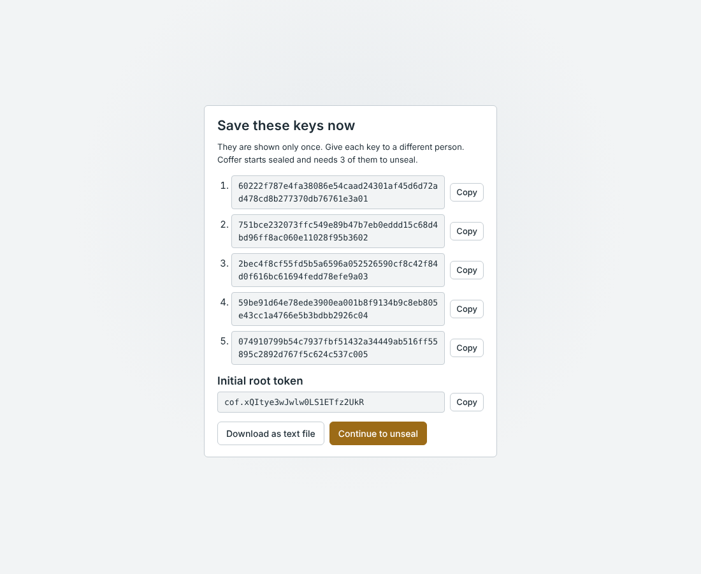
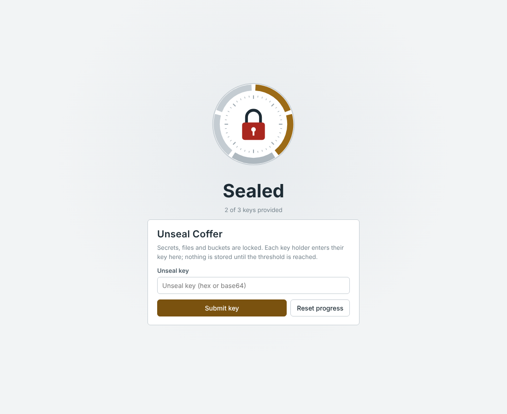
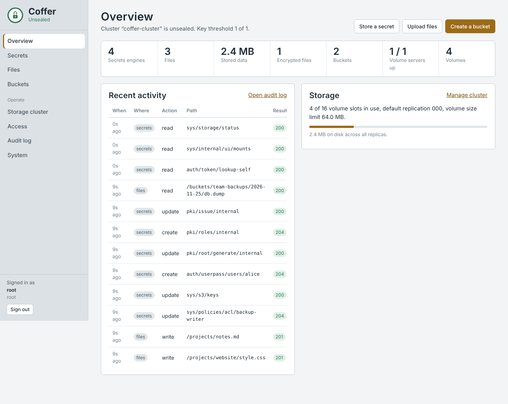
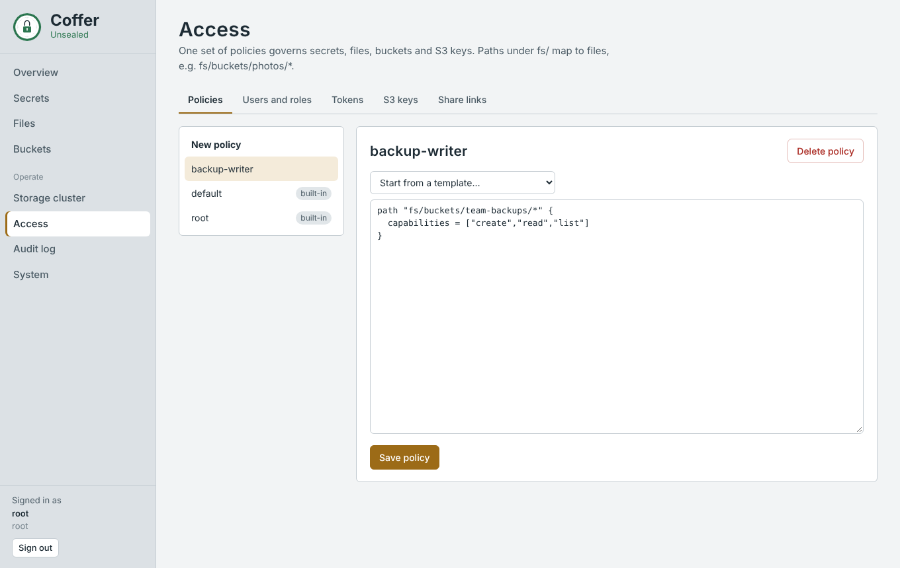
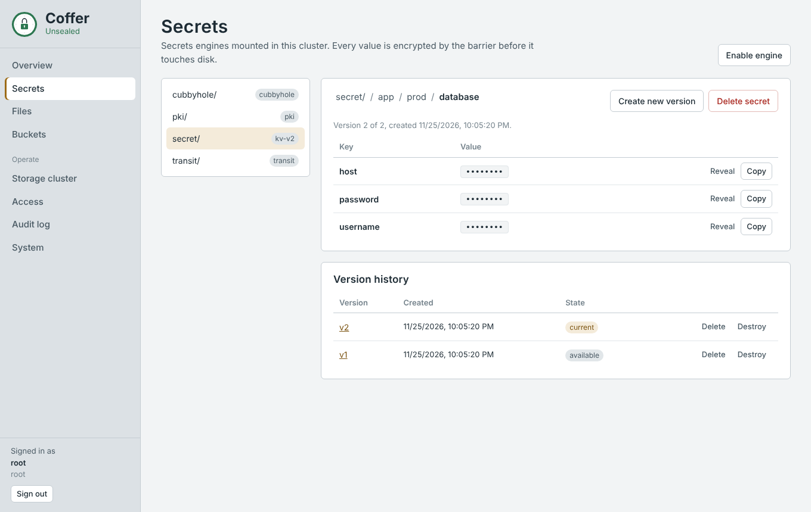
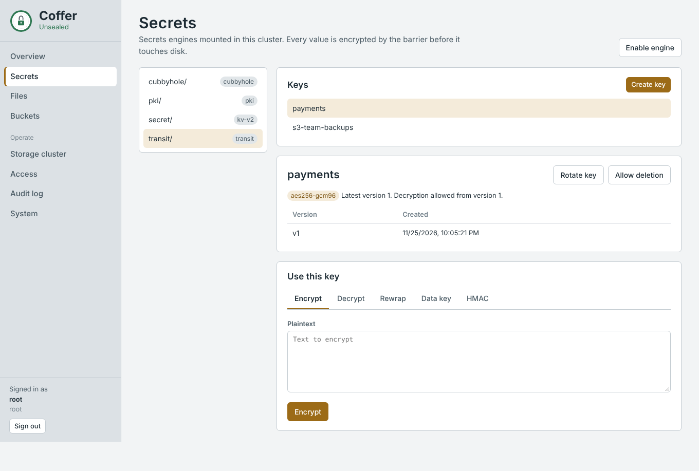
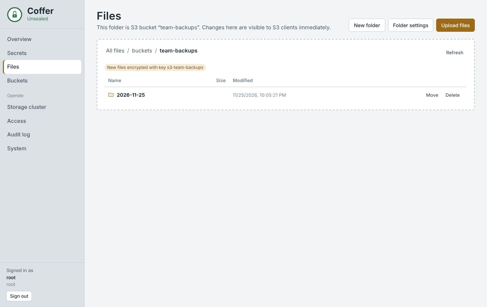
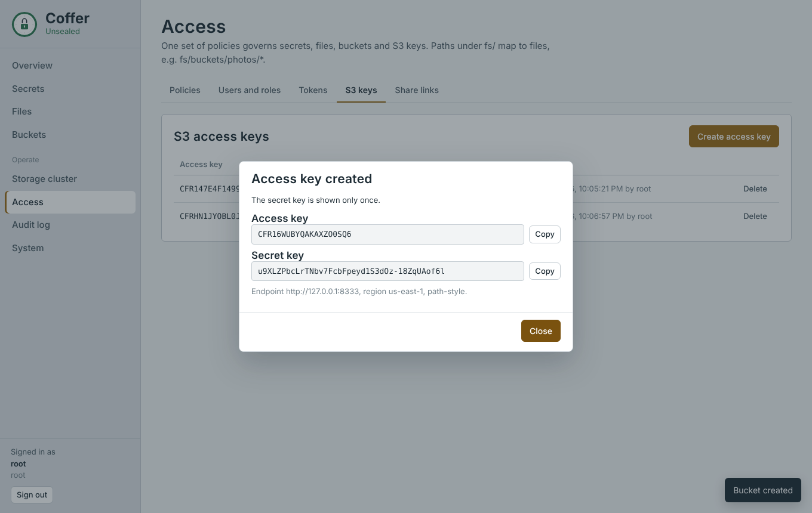
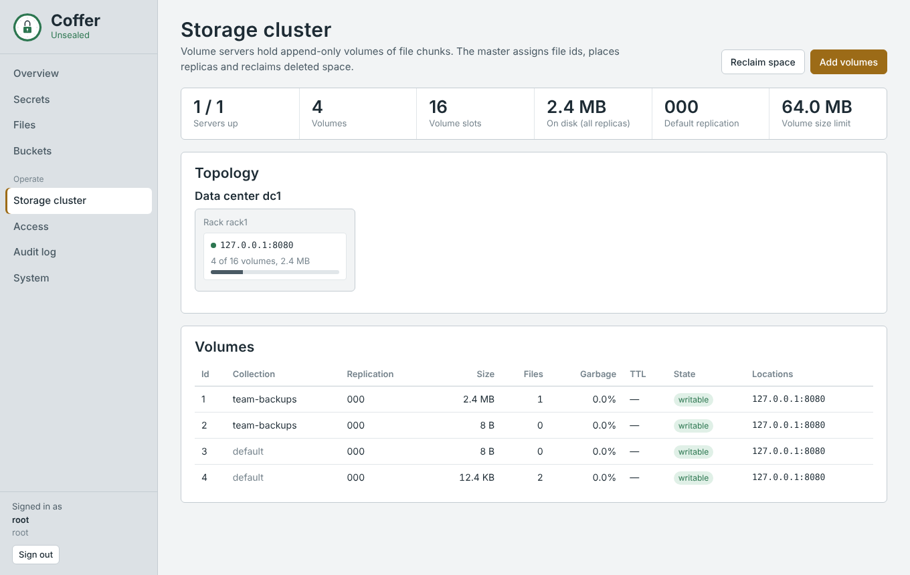

# User guide

This guide walks through Coffer as a new team would use it: first start, unseal,
storing secrets, setting up encrypted storage for a backup job, connecting S3
clients, sharing files and responding to an incident. Every step is shown in the web
console and with the CLI.

* Console: `http://<host>:8200/ui/`
* CLI: set `COFFER_ADDR=http://<host>:8200`, then `coffer login` (or set
  `COFFER_TOKEN`).

## 1. First start: initialize

Start a production‑style server (not dev mode):

```bash
coffer server -dir=/var/lib/coffer
```

Open the console. Because Coffer has never been initialized you see the
**Initialize** screen. Choose how many **key shares** to create and how many are
needed to unseal (the **threshold**), e.g. 5 and 3, and click **Initialize**.



You get the unseal keys and the initial root token **once**. Give each key to a
different person (or store them in separate password managers). Download the text
file only if you will move it somewhere safe right away.

CLI equivalent:

```bash
coffer operator init -key-shares=5 -key-threshold=3
```

## 2. Unseal

Coffer always starts **sealed**: it knows where its data is but cannot decrypt
any of it. Each key holder opens the console and enters their key. The dial on the
unseal screen has one segment per key share; submitted keys turn brass, and the
darker segments show how many are still needed.



```bash
coffer operator unseal      # each key holder runs this with their own key
coffer status               # sealed=false once the threshold is reached
```

Then sign in with the root token. For everyday work, create named users (step 4)
and keep the root token locked away; you can always mint a new one later with
`coffer operator generate-root -keys=…`.

## 3. The console at a glance



| Section | What it is for |
|---|---|
| **Overview** | Seal state, counts, recent activity, storage capacity |
| **Secrets** | Browse and edit secrets in every engine; transit, PKI and TOTP tools |
| **Files** | File manager: upload (button or drag and drop), folders, move, copy, share, folder settings |
| **Buckets** | S3 buckets: create, encrypt, make public or private, delete; client setup snippets |
| **Storage cluster** | Data centers, racks, volume servers, volumes; add volumes, reclaim space |
| **Access** | Policies, users and AppRoles, tokens, S3 access keys, share links |
| **Audit log** | Log destinations and a live, filterable event feed |
| **System** | Seal now, rotate the encryption key, engines, permission checker, response wrapping, rekey |

The small dial at the top of the sidebar always shows the live seal state.

## 4. People and permissions

### Write a policy

**Access → Policies → New policy**, or start from a template. Policies are lists of
paths and capabilities:

```hcl
# Developers: read app secrets, full access to their project folder
path "secret/data/app/*"     { capabilities = ["read"] }
path "secret/metadata/app/*" { capabilities = ["list", "read"] }
path "fs/projects/web/*"     { capabilities = ["create", "read", "update", "delete", "list"] }
path "fs/projects/web"       { capabilities = ["read", "list"] }
```



Rules of thumb:

* Secrets in KV v2 use `secret/data/…` for values and `secret/metadata/…` for
  listing and history.
* Files use `fs/` + the file path; buckets are `fs/buckets/<bucket>/…`.
* `*` matches any suffix, `+` matches exactly one path segment.
* The most specific path wins; `deny` beats everything.
* Check what a token can do with **System → Check permissions**.

### Create users

**Access → Users and roles → Create user**: username, password (8+ characters) and
policies. Users sign in on the console's *Username* tab or with:

```bash
coffer login -method=userpass username=alice
```

Five wrong passwords lock a user out for 15 minutes.

For machines and CI use **AppRole**: enable it under *Sign‑in methods*, create a
role with policies, then **Generate credentials** to get a role id and a single‑use
or time‑limited secret id.

## 5. Secrets

**Secrets → secret/ → Create secret**. Paths with slashes create folders
(`app/prod/database`). Values are masked until you click **Reveal**.



* **Create new version** keeps history; previous versions stay readable.
* **Delete** on a version is a soft delete (restorable); **Destroy** removes the
  data permanently.
* Writes from the console use check‑and‑set, so two people editing at once cannot
  silently overwrite each other.

```bash
coffer kv put secret/app/prod/database username=svc password='s3cr3t'
coffer kv get secret/app/prod/database
coffer kv get -version=1 secret/app/prod/database
coffer kv delete secret/app/prod/database          # soft delete
coffer kv undelete -versions=2 secret/app/prod/database
```

### Encryption as a service (transit)

Applications can encrypt data without ever seeing the key: **Secrets → transit/ →
Create key**, then use the **Use this key** panel (encrypt, decrypt, rewrap, data
key, HMAC; sign/verify for Ed25519 and ECDSA keys).



```bash
curl -s -H "X-Coffer-Token: $COFFER_TOKEN" -X POST $COFFER_ADDR/v1/transit/encrypt/payments \
  -d "{\"plaintext\":\"$(echo -n 'card 4111' | base64)\"}"
# -> {"data":{"ciphertext":"coffer:v1:…","key_version":1}}
```

**Rotate key** whenever you like: new data uses the new version, existing
ciphertext keeps working, and **Rewrap** upgrades old ciphertext without exposing
plaintext.

### Certificates (PKI)

**Secrets → pki/**: generate a root CA, create a role (allowed domains, TTLs), then
**Issue certificate**. The private key is shown once; Coffer keeps only the
certificate. Revoked certificates appear in the CRL at `/v1/pki/crl/pem`.

## 6. Walkthrough: encrypted backups for a team

**Goal:** a backup job writes nightly dumps into a bucket. Everything in the bucket
is encrypted, the job can't read anything else, and an engineer can hand a restore
copy to a colleague.

1. **Create the bucket** – *Buckets → Create bucket*, name `team-backups`, keep
   *Encrypt objects with a dedicated transit key* ticked. Coffer creates the transit
   key `s3-team-backups` and applies it to the bucket.

   

2. **Write the policy** – *Access → Policies → New policy* → template *Bucket
   read/write*, replace `my-bucket` with `team-backups`, drop `delete` and
   `update` if the job should only add files, save as `backup-writer`.

3. **Create an access key** – *Access → S3 keys → Create access key*, policies
   `backup-writer`. Copy the access key and secret key (shown once).

   

4. **Configure the job** (any S3 client works – AWS CLI, rclone, restic, boto3,
   MinIO client):

   ```bash
   export AWS_ACCESS_KEY_ID=CFR…  AWS_SECRET_ACCESS_KEY=…  AWS_DEFAULT_REGION=us-east-1
   aws --endpoint-url http://coffer.internal:8333 s3 cp db.dump s3://team-backups/2026-11-25/db.dump
   ```

5. **Verify** – *Files → buckets → team-backups*: the file shows an *encrypted*
   tag; *Details* shows how it was chunked and which key protects it. *Audit log*
   shows the S3 write with the key that made it.

6. **Share a restore copy** – on the file choose **Share**, pick *1 day* and a
   download limit of 1. Send the link; it stops working after one download or one
   day, whichever comes first. Active links are listed under *Access → Share links*
   where you can revoke them.

7. **Keep it tidy** – set **Folder settings → Expire files after** = `30d` on the
   bucket so old dumps are removed automatically, and **Replication** = `010` to
   keep two copies on different racks.

## 7. Files without S3

The **Files** page works on any folder, not just buckets.

* Upload with the button or by dragging files onto the list. Large files are
  streamed in 4 MB chunks.
* **Move** is instant even for big folders (only metadata changes). **Copy**
  re‑encrypts data according to the destination folder's settings.
* **Folder settings** apply to new files below a folder: encryption key, replication
  and expiry. Existing files keep their protection.
* **Download** creates a single‑use, two‑minute link behind the scenes, so even
  very large files stream directly from the server.

```bash
coffer fs mkdir /projects/web
coffer fs put ./site.tar.gz /projects/web/
coffer fs encrypt -key=web-files /projects/web       # encrypt future uploads
coffer fs ls /projects/web
coffer fs mv /projects/web/site.tar.gz /archive/site-2026.tar.gz
coffer fs share -ttl=2h /archive/site-2026.tar.gz
```

## 8. Handing over a secret safely

Instead of pasting a password into chat, wrap it: **System → Response wrapping**,
enter JSON such as `{"password":"…"}`, click **Wrap** and send the token. The
recipient unwraps it once (same panel, or `POST /v1/sys/wrapping/unwrap`). If
someone intercepted and used the token first, the recipient's unwrap fails – a clear
signal of tampering. Any API response can be wrapped by adding the header
`X-Coffer-Wrap-TTL: 15m`; the *Create a token* form has a checkbox for it.

## 9. Incident response

| Situation | Action |
|---|---|
| A token or key leaked | *Access → Tokens → Revoke a token* (by accessor) or delete the S3 key. Children of a revoked token are revoked too. |
| A user left | Delete the user; rekey the unseal keys if they held one (*System → Rekey*). |
| Suspected compromise of the host | *System → Seal now*. Every secret, encrypted file and S3 object becomes unreadable until key holders unseal. |
| Investigate | *Audit log*: filter by path or type; click an event for full detail. Add a log file destination for a permanent record. |
| Long‑lived encryption key | *System → Rotate key* (barrier) and *Rotate key* on transit keys. |

## 10. Cluster care

*Storage cluster* shows each data center, rack and volume server with its slot
usage, plus every volume's size, file count, garbage ratio and replicas.



* **Add volumes** pre‑creates capacity for a collection/replication (normally this
  happens automatically).
* **Reclaim space** compacts volumes with deleted data; Coffer also does this every
  15 minutes for volumes above 30% garbage.
* A volume marked *degraded* has fewer live replicas than its replication requires;
  it stays readable but receives no new writes until the server returns.

See [Operations](OPERATIONS.md) for adding servers, TLS, backups and monitoring.
